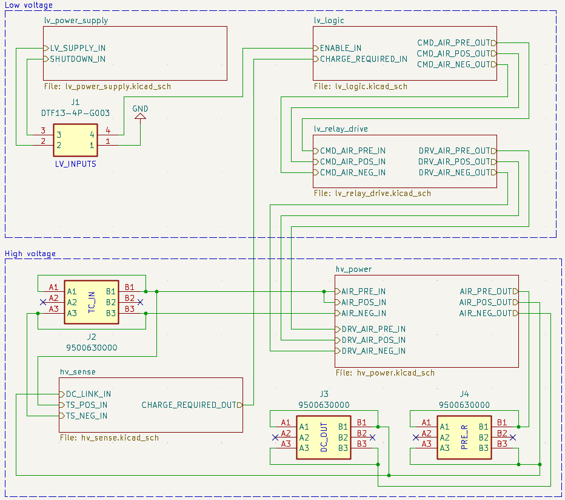

# Precharge-controller's description file

## Table of Contents
- [Precharge-controller's description file](#precharge-controllers-description-file)
  - [Table of Contents](#table-of-contents)
  - [1. Architecture overview](#1-architecture-overview)
  - [2. Power supply \& Current Budget](#2-power-supply--current-budget)
    - [2.1 Protection circuit and regulation](#21-protection-circuit-and-regulation)
    - [2.2 Current budget](#22-current-budget)
    - [2.3 Regulator power dissipation](#23-regulator-power-dissipation)
  - [3. Low voltage logic](#3-low-voltage-logic)
    - [3.1 ENABLE Level Shifter and Timer](#31-enable-level-shifter-and-timer)
    - [3.2 SR latch and completion memory](#32-sr-latch-and-completion-memory)
    - [3.3 Loss of supply protection](#33-loss-of-supply-protection)

## 1. Architecture overview

This document details the design of the hardware-only precharge controller for a Formula SAE electric vehicle. The system architecture is physically and galvanically divided into two distinct domains: low voltage (LV) and high voltage (HV).

The low voltage domain features: 
- **Power supply** block: Stabilizes the unregulated LV input and protects the board from reverse polarity and transient overvoltages.
- **Logic** block: Uses discrete CMOS logic to evaluate safety conditions, implement an asymmetric 50ms timer, and provide a fail-safe completion memory without programmable devices.
- **Relay drive** block: Controls the three main relay coils using the safety shutdown supply and low-side NMOS drivers.

The high voltage domain features:
- **Sensing** block: Utilizes dual high-impedance voltage dividers, an isolated DC/DC converter, and an analog comparator to safely confirm the 95% DC-link charge state.
- **block**: Contains the external accumulator insulation relays (AIR+, AIR-), the precharge relay, and the precharge power resistor.

    

## 2. Power supply & Current Budget

This section details the power distribution, protection mechanisms, and thermal verification of the internal power supply block, ensuring operation across the specified 16-26V DC main supply and 12V shutdown supply ranges.

### 2.1 Protection circuit and regulation

Both LV_LOGIC and LV_SHUTDOWN lines are protected against: 
- **Reverse polarity:** using a PMOS transistor configured with a Zener diode, ensuring $V_{GS}$ protection to the PMOS.
- **Transient overvoltage:** using a TVS diode, chosen because of its ability to withstand high voltage spikes.

LV_LOGIC line is stabilized by a L7812ABV linear voltage stabilizer to generate a linear +12V supply. 
LV_SHDW already comes stabilized, but it needs bypass filters in order to protect the line by the EMI of relay coils.

### 2.2 Current budget

The current consumption is divided between two independent supplies:
- **+12_LOGIC:**  The logic chips draws negligible quiescent current (under 1 mA). The primary loads are the linear regulator and the DEP1-12-S12-M DC/DC converter (with an efficienzy of 80%), which supplies a LM393B comparator and a APC817D1 optocoupler used to galvanically isolate low and high domain. The total maximum continous current draw on the linear regulator is around $4.0\space mA$.

$$
I_{max} = I_{IC1} + I_{IC2} + I_{IC3} + I_{IC5} + I_{PS1}
$$
$$
I_{PS1} = \frac{I_{DCDCout}}{\text{DCDC efficiency}} = \frac{\frac{12\space V - V_{Q7}}{R9} + I_{IC4}}{\text{0.80}}
$$
$$
I_{max} \approx 4.3\text{ mA} + 5\space \mu\text{A} + 5\space \mu\text{A} + 5\space \mu\text{A} +  \frac{\frac{12\text{ V} - 1.2\text{ V}}{4.7\text{ k}\Omega} + 0.8\text{ mA}}{0.80} \approx 8 \text{ mA}
$$

- **+12_SHDW:** The three G9KB-1A12V relays are powered only by the shutdown circuit. Using an RC voltage holder, the consumption per coil is reduced approximately to $117\text{ mA}$ at $6\text{ V}$ (according to datasheet). A maximum of two relays are energized at the same time. Therefore, the maximum, continuous current draw is around $234\text{ mA}$.

$$
I_{max} = I_{U2} + I_{U3} \approx 117\text{ mA} + 117\text{ mA}= 234\text{ mA}
$$

### 2.3 Regulator power dissipation

The L7812ABV regulator steps down the 16-24V input to stable 12V, because the relays are powered by the shutdown line, the low voltage supplies only the logic domain. 
The worst-case continous power disipation is calculated as:

$$ P_{dis} = (V_{in \space max} - V_{out}) \cdot I_{logic \space max} + V_{in \space max} \cdot I_{IC1} $$
$$ P_{dis} \approx (24 \text{ V} - 12 \text{ V}) \cdot 4 \text{ mA} + 24\text{ V} \cdot 4.3\text{ mA} \approx 151 \text{ mW} $$

This result is not concerning for heat dissipation, therefore IC1 does not require additional cooling components

## 3. Low voltage logic

This section details the logic circuit responsible of controlling the relay drive block, based on two primary inputs: an external ENABLE signal and a CHARGE_REQUIRED signal from the high-voltage sensing block. The logic drives three distinct outputs: CMD_AIR_PRE (precharge relay), CMD_AIR_POS (positive AIR), and CMD_AIR_NEG (negative AIR).

### 3.1 ENABLE Level Shifter and Timer

The external ENABLE signal is level-shifted by an N-MOSFET to safely match the internal 12V CMOS logic domain. The shifted line is connected to a 50 ms timer implemented using an RC network and a Schmitt trigger inverter (IC3). At board startup, if the enable signal is low, the capacitor charges towards 12V imediatly. If the enable signal is high, the capacitor is held discharged to ground; the inverter reads a low input and its output goes high. During operation, if the enable signal goes low, the capacitor starts to charge. Once the $V_p = 7.1\space V$ threshold of the Schmitt trigger is reached, the inverter interprets the input as a logic high, which results in a delayed falling edge of the final output.
A simulation of this circuit, done with LTspice, is available [here](/hardware/sim/enabe_timer.asc).

### 3.2 SR latch and completion memory

The core sequencing and state retention are managed by a discrete set-reset (SR) latch architecture built using cross-coupled logic gates. 
- **Sequence Initiation:** When the system is powered on, the shutdown supply is verified, and the ENABLE signal is asserted high, the latch initiates the precharge sequence by closing AIR− and the precharge relay, while keeping positive AIR open.
- **Completion Memory:** Once the high-voltage sensing circuit determines that the DC-link voltage has reached $95\%$ of the traction system potential, the CHARGE_REQUIRED signal goes down. This event triggers the completion memory logic, switching the SR latch state to decouple the precharge resistor branch and command the closure of the positive AIR contactor (CMD_AIR_POS), ensuring the system remains latched in the fully operational state until a shutdown command occurs.

### 3.3 Loss of supply protection

To comply with safety requirements regarding power loss and fault contingencies, a robust monitoring and reset mechanism is integrated into the logic domain:
- **Shutdown and Low-Voltage Supervision:** The circuit continuously tracks the integrity of both the $12\text{ V}$ shutdown safety supply and the unregulated low-voltage lines.
- **Fail-Safe Response:** If the shutdown supply or the low-voltage auxiliary supply drops below operating thresholds, or if the ENABLE signal is removed for more than $50\text{ ms}$, the protection logic overrides the SR latch state. This forces all relay control outputs (CMD_AIR_PRE, CMD_AIR_POS, CMD_AIR_NEG) to actively open within a maximum of $250\text{ ms}$, safely isolating the high-voltage Traction System from the inverter.

<TODO calculate precise opening time>

